# Production-Ready Dokploy on Oracle Cloud (Terraform)

[](https://opensource.org/licenses/MIT)
[](https://www.terraform.io/)
[](https://www.oracle.com/cloud/free/)
[](https://tailscale.com/)
[](https://www.cloudflare.com/)
[](https://bitwarden.com/)

This project provisions a secure, production-ready **Dokploy** instance on Oracle Cloud Infrastructure's "Always Free" Ampere A1 compute, entirely with Terraform. It implements a **security-first architecture**: the Dokploy admin dashboard and SSH stay completely private on a [Tailscale](https://tailscale.com/) network, while applications are exposed to the public internet through an outbound-only [Cloudflare Tunnel](https://www.cloudflare.com/products/tunnel/). Secrets are never stored in the repo — they are fetched at runtime from [Bitwarden Secrets Manager](https://bitwarden.com/products/secrets-manager/).

A common use for an instance like this is self-hosting **n8n** (and its supporting Postgres/Redis/Traefik stack) behind the private dashboard, with only the webhook/app endpoints exposed via the tunnel.

> **Provenance:** This is a cleaned-up reference version of infrastructure I built for my own production use and run daily, and have since deployed the same stack for a client. It is published so the actual code and structure are inspectable.

---

## Architecture: secure by default

```mermaid
graph TD
    subgraph Your Private Tailscale Network
        A[Your Machine] --> B{OCI Server};
        B --> C[Dokploy Port: 3000];
        B --> D[SSH Port: 22];
    end

    subgraph Public Internet
        F[User's Browser] --> G(Cloudflare Edge);
    end

    subgraph OCI Server
        E[cloudflared] --> H{Traefik Port: 80};
        H --> I[App Container];
    end

    G -- Encrypted Tunnel --> E;

    style B fill:#222,stroke:#333,stroke-width:2px
    style F fill:#222,stroke:#333,stroke-width:2px
```



| Component | Access level | Network | Purpose |
| :--- | :--- | :--- | :--- |
| **Dokploy dashboard** | Private | Tailscale VPN | Server and app management |
| **SSH access** | Private | Tailscale VPN | Secure shell administration |
| **Deployed apps** | Public | Cloudflare Tunnel | Publicly accessible over HTTPS |

---

## Key features

-   **Fully automated**: complete infrastructure setup with one command (`make apply`).
-   **Secure by default**: the Dokploy admin panel and SSH are never exposed to the public internet.
-   **No public firewall ports**: all public traffic is routed through an outbound-only Cloudflare Tunnel.
-   **Secrets management**: credentials are injected at runtime from Bitwarden Secrets Manager, never committed.
-   **Simple workflow**: a `Makefile` wraps the common commands (`make plan`, `make apply`, `make verify`).
-   **Production hardening**: SSH hardening, fail2ban, automatic security updates, and a post-deployment health-check script.

---

## Quick start

This assumes you have met the prerequisites. See the `docs/` folder for detailed, step-by-step setup.

1.  **Clone the repository**

    ```bash
    git clone git@github.com:Bangbuild-Solutions/oci-n8n-dokploy-terraform.git
    cd oci-n8n-dokploy-terraform/
    ```

2.  **Configure your deployment**

    Copy the example file and edit it with your values (compartment OCID, SSH key, hostname, etc.). Keep the final file minimal — comments count against OCI's cloud-init size limit.

    ```bash
    cp terraform.tfvars.example terraform.tfvars
    nano terraform.tfvars
    ```

3.  **Set up secrets**

    Configure your Bitwarden access token and project ID as environment variables. See [docs/04-BITWARDEN-SETUP.md](./docs/04-BITWARDEN-SETUP.md).

    ```bash
    export BWS_ACCESS_TOKEN='your_bitwarden_access_token'
    export BWS_PROJECT_ID='your_bitwarden_project_id'
    ```

4.  **Deploy the infrastructure**

    ```bash
    make init
    make apply
    ```

    This takes roughly 15-20 minutes.

5.  **Verify and access**

    Once deployment completes, connect to your Tailscale network and run the verification script.

    ```bash
    make verify
    ```

    You can then reach the private Dokploy dashboard at `http://<your-tailscale-hostname>:3000`.

---

## What gets provisioned

-   An OCI VCN, internet gateway, route table, security list, and public subnet.
-   A `VM.Standard.A1.Flex` Ampere instance (4 OCPU / 24 GB, Always Free), optional extra block volume for Docker data.
-   Cloud-init that installs and configures Docker (Swarm mode), Tailscale, Cloudflare Tunnel, and Dokploy, plus SSH hardening, fail2ban, and unattended security upgrades.
-   The OCI security list allows SSH only from the Tailscale CGNAT range (`100.64.0.0/10`) and Tailscale's UDP port — no public 80/443 at the cloud firewall, since all app traffic arrives through the outbound Cloudflare Tunnel.

---

## Documentation

Detailed guides live in `docs/`. Start with the prerequisites and follow them in order.

-   [docs/01-ARCHITECTURE.md](./docs/01-ARCHITECTURE.md): high-level architecture.
-   [docs/02-PREREQUISITES.md](./docs/02-PREREQUISITES.md): required accounts and tools.
-   [docs/03-OCI-SETUP.md](./docs/03-OCI-SETUP.md): getting your Oracle Cloud credentials.
-   [docs/04-BITWARDEN-SETUP.md](./docs/04-BITWARDEN-SETUP.md): setting up Bitwarden Secrets Manager.
-   [docs/05-TAILSCALE-SETUP.md](./docs/05-TAILSCALE-SETUP.md): configuring Tailscale and ACLs.
-   [docs/06-CLOUDFLARE-SETUP.md](./docs/06-CLOUDFLARE-SETUP.md): setting up Cloudflare and the tunnel.
-   [docs/07-DEPLOYMENT.md](./docs/07-DEPLOYMENT.md): deployment walkthrough.
-   [docs/08-POST-DEPLOYMENT.md](./docs/08-POST-DEPLOYMENT.md): verifying and exposing applications.
-   [docs/09-TROUBLESHOOTING.md](./docs/09-TROUBLESHOOTING.md): common issues and fixes.
-   [docs/10-MAINTENANCE.md](./docs/10-MAINTENANCE.md): ongoing maintenance.

---

## License

MIT. See [LICENSE](./LICENSE).
